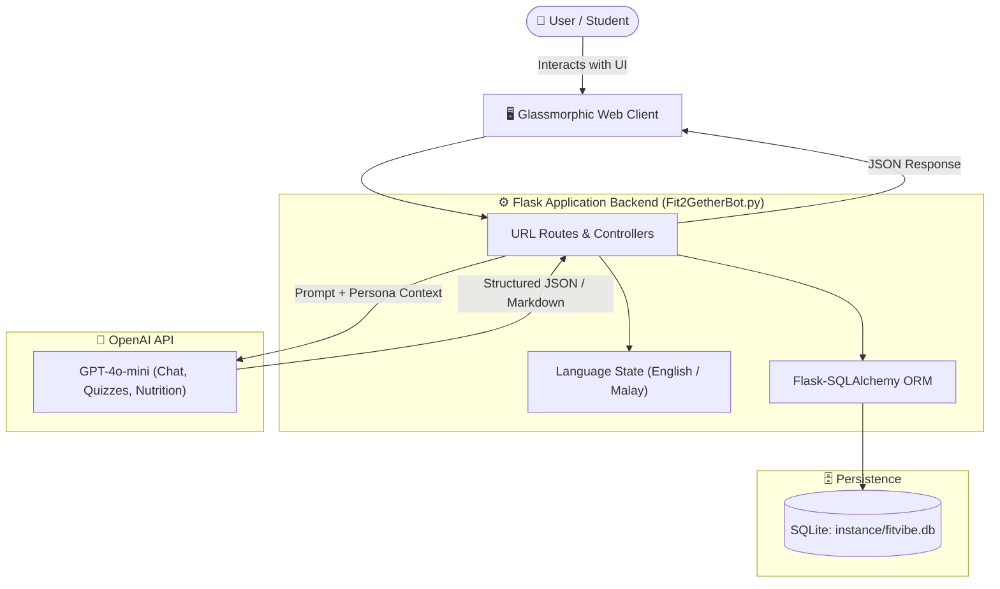

# 🏋️ Fit2gether — AI Fitness Architect & Gamified Health Assistant

[](https://www.python.org/)
[](https://flask.palletsprojects.com/)
[](https://platform.openai.com/)
[](https://www.sqlite.org/)
[](https://developer.mozilla.org/en-US/docs/Web/HTML)
[](LICENSE)

> **Fit2gether** is an intelligent, gamified fitness coaching web application powered by **OpenAI GPT-4o-mini** and **Flask**. Designed specifically for students and young adults, it delivers adaptive conversational fitness guidance, on-the-fly bilingual support (English & Bahasa Melayu), instant AI-powered nutritional breakdown, and interactive multiple-choice fitness quizzes with real-time XP progression.

---

## 📌 Problem Statement & Solution

Maintaining a consistent workout and dietary routine is notoriously difficult for university students and young professionals due to erratic schedules, high personal trainer costs, and fragmented information across fitness blogs.

**Fit2gether** addresses this by serving as an always-available, pocket-sized AI Fitness Coach:
* **Adaptive AI Persona:** Powered by OpenAI GPT-4o-mini with system prompts that enforce structured, actionable workout regimens and concise scientific explanations.
* **Bilingual Flexibility:** Instant dynamic toggling between **English** and **Bahasa Melayu**, adjusting both the chatbot tone and generated fitness quizzes.
* **Nutritional Estimation Engine:** Natural language meal logging that parses descriptions (e.g., *"Nasi lemak with fried egg and sambal"*) into estimated calories and macronutrient insights.
* **Gamified XP & Habit Formation:** Users earn Experience Points (XP) for asking workout questions (+20 XP), completing daily fitness quizzes (+30 XP), and logging meals (+10 XP), stored in a persistent SQLite database.

---

## 🚀 Core Features & Architecture



### 1. 🤖 Elite AI Fitness Architect Persona
* Uses curated system personas configured to deliver structured, bulleted workout advice, form-correction cues, rest day protocols, and cardio vs. resistance guidelines.

### 2. 🇲🇾 Dynamic Bilingual Language Switcher
* Users can switch between English and Malay with a single click. All downstream OpenAI completions (coaching answers, quiz questions, and nutrition analyses) immediately adapt to the selected language.

### 3. 🎯 AI-Generated Fitness Quiz (`/get_quiz`)
* Dynamically requests GPT-4o-mini to generate valid JSON containing 1 multiple-choice fitness question across topics like *Hydration, Protein, Compound movements, BMI,* and *Rest days*, preventing repeated or stale questions.

### 4. 🥗 Instant Nutrition & Calorie Estimator (`/log_nutrition`)
* Users type what they ate in plain text. The AI calculates an estimated calorie count and brief macronutrient summary in under 25 words.

### 5. 🏆 Gamified Progression Engine (`/update_xp`)
* Integrates `UserStats` via SQLAlchemy. Actions continuously award points to encourage daily fitness reflection and consistency.

---

## 🔌 API Endpoints Summary

| Endpoint | Method | Payload / Params | Response | Description |
|---|---|---|---|---|
| `/` | `GET` | None | HTML | Renders main interactive dashboard and loads current XP |
| `/set_language` | `POST` | `{"lang": "ms" \| "en"}` | `{"status": "success"}` | Sets global response language for the session |
| `/chat` | `POST` | `{"message": "..."}` | `{"response": "...", "points": n}` | Streams user prompt to GPT-4o-mini with persona context; awards +20 XP |
| `/get_quiz` | `GET` | None | JSON object (`question`, `options`, `correct_index`) | Generates 1 dynamic fitness MCQ in the active language |
| `/log_nutrition` | `POST` | `{"meal": "..."}` | `{"analysis": "...", "points": n}` | AI food estimator; returns concise calorie breakdown; awards +10 XP |
| `/update_xp` | `POST` | `{"change": n}` | `{"points": n}` | Commits XP delta to persistent SQLite storage |

---

## 📂 Project Directory Structure

```text
Fit2gether_ChatBot_AI/
├── README.md                      # Comprehensive project documentation
├── requirements.txt               # Top-level dependencies for quick pip install
├── .gitignore                     # Ignores runtime DBs, virtualenvs, and raw API keys
└── Fit2gether/                    # Primary application package
    ├── Fit2GetherBot.py           # Core Flask backend, OpenAI client & routes
    ├── requirements.txt           # Package-level requirements
    ├── app.env.example            # Environment variables template
    ├── instance/                  # Local SQLite database directory (auto-created)
    │   └── fitvibe.db             # Auto-generated on first app launch
    ├── static/                    # Application icons, styling, and client assets
    │   └── icons/
    │       └── gym.png
    └── templates/                 # Frontend templates
        └── index.html             # Responsive glassmorphic chat and quiz UI
```

---

## 🛠️ Step-by-Step Installation & Setup

### 1. Prerequisites
* **Python:** Version 3.9 or newer installed (`python --version` or `py --version`).
* **OpenAI API Key:** Active key from the [OpenAI Platform](https://platform.openai.com/api-keys).

### 2. Clone the Repository
```bash
git clone https://github.com/akhmal02/Fit2gether_ChatBot_AI.git
cd Fit2gether_ChatBot_AI
```

### 3. Create a Virtual Environment (Recommended)
```bash
python -m venv .venv

# On Windows:
.venv\Scripts\activate

# On macOS/Linux:
source .venv/bin/activate
```

### 4. Install Dependencies
```bash
pip install -r requirements.txt
```

### 5. Configure Your OpenAI API Key
1. Copy the example environment file inside `Fit2gether`:
   ```bash
   cp Fit2gether/app.env.example Fit2gether/app.env
   ```
2. Open `Fit2gether/app.env` and paste your OpenAI API key:
   ```env
   OPENAI_API_KEY=sk-proj-YourActualOpenAIKeyHere
   ```

### 6. Run the Application
Navigate to the `Fit2gether` directory and launch the Flask server:
```bash
cd Fit2gether
python Fit2GetherBot.py
```

Open your web browser and navigate to:
```text
http://127.0.0.1:5000/
```

---

## 👨‍💻 Author & Academic Attribution
* **Developer:** Muhammad Akhmal bin Mohamad Hussin ([@akhmal02](https://github.com/akhmal02))
* **Institution:** Universiti Teknologi MARA (UiTM)
* **Faculty:** College of Computing, Informatics and Mathematics
